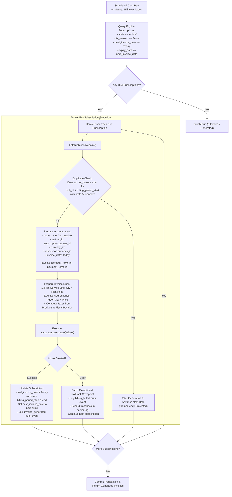

# SUBSCRIBO Phase 3 — Recurring Invoicing & Billing Automation
## Architecture Audit & Technical Design Specification

**Environment**: Odoo 19.0 Community Edition (`C:\odoo-custom-addons\subscribo`)  
**Frontend**: Independent React + TypeScript + Vite SaaS (`C:\subscribo-frontend`)  
**Database**: Isolated Test Database (`subscribo_phase1_test_20261031`)  
**Phase**: Phase 3 — Recurring Invoicing & Billing Automation  
**Status**: Architecture Design Complete — Awaiting Approval  

---

## 1. Existing Architecture Findings

1. **Subscription Model (`subscribo.subscription`)**:
   - Manages the core contract lifecycle (`draft` → `quotation` → `confirmed` → `active` → `closed`), along with start date, expiry date, currency, plan, quantity, and financial amounts (`amount_untaxed`, `amount_tax`, `amount_total`).
   - Supports operational pause (`is_paused`), add-ons (`subscribo.subscription.addon`), and immutable audit event history (`subscribo.subscription.event`).
   - **Current Gap**: Contains **no** connection to Odoo's invoice model (`account.move`), no billing cycle tracking fields (`last_invoice_date`, `next_invoice_date`), and no automated billing status indicators.
2. **Subscription Plans (`subscribo.plan`)**:
   - The plan model already defines `billing_period` selection with:
     ```python
     billing_period = fields.Selection([
         ('daily', 'Daily'),
         ('weekly', 'Weekly'),
         ('monthly', 'Monthly'),
         ('yearly', 'Yearly'),
     ], required=True, default='monthly')
     ```
   - Specifies `price`, `service_product_id`, `minimum_quantity`, and policy flags (`auto_close_at_end`, `allow_pause`, `allow_renewal`).
3. **Sale Orders & Lines**:
   - `sale.order` represents initial contract quotations and add-on change requests.
   - Contains standard Odoo invoicing methods (`_create_invoices()`), but in subscription contracts, recurring billing must generate invoices cycle-by-cycle throughout the subscription term without altering the initial sale order status.
4. **Odoo Accounting Engine (`account.move`)**:
   - Standard Odoo 19 Community customer invoices use `account.move` with `move_type = 'out_invoice'`.
   - The test database already has standard Sales Journals (`account.journal` code `INV`).
   - Product tax mapping (`tax_ids`) and payment terms (`account.payment.term`) exist and are active.
5. **Scheduled Actions**:
   - `data/subscription_cron.xml` contains `ir_cron_subscribo_auto_close` (running daily to close expired subscriptions).
   - No recurring invoicing cron exists.
6. **Frontend State**:
   - The React frontend at `C:\subscribo-frontend` connects to Odoo via Vite proxy and currently features placeholder screens for Invoices.

---

## 2. Missing Backend Functionality

To satisfy Phase 3 requirements (R05, R18, R19, R20, R21), the following backend components must be introduced:

1. **Cycle Tracking & Schedule State**: Fields on `subscribo.subscription` tracking `last_invoice_date`, `next_invoice_date`, `billing_period_start`, `billing_period_end`, and `billing_status`.
2. **Subscription-Invoice Linkage**: Relational link on `account.move` pointing back to `subscribo.subscription`, with an inverse One2many relation `invoice_ids` on the subscription.
3. **Date Math Engine**: Calculation algorithms for Daily, Weekly, Monthly, and Yearly intervals handling month-end boundaries (e.g. Jan 31 → Feb 28/29) and year transitions.
4. **Recurring Invoice Generator**: Method `_generate_recurring_invoice()` creating an `out_invoice` with:
   - Correct plan service line (quantity × plan price).
   - All active add-ons as separate lines with configured prices.
   - Applicable product taxes and fiscal positions.
   - Payment terms and calculated due dates.
5. **Duplicate Protection & Idempotency Engine**: Validation logic ensuring that retrying a billing run never produces duplicate invoices for the same subscription period.
6. **Billing Scheduled Action (Cron)**: Automated action querying due active subscriptions, executing with per-subscription savepoints so a failure in one customer's subscription does not roll back others, and logging full audit events.
7. **Security & Access Control**: Record rules on `account.move` ensuring customers can access only their own invoices.

---

## 3. Proposed Database Fields & Relationships

### 3.1 Extensions to `subscribo.subscription`

```python
# In models/subscription.py

invoice_ids = fields.One2many(
    'account.move',
    'subscribo_subscription_id',
    string='Invoices',
    readonly=True,
)
invoice_count = fields.Integer(
    string='Invoice Count',
    compute='_compute_invoice_count',
)
last_invoice_date = fields.Date(
    string='Last Invoice Date',
    readonly=True,
    copy=False,
)
next_invoice_date = fields.Date(
    string='Next Invoice Date',
    index=True,
    copy=False,
    tracking=True,
)
billing_period_start = fields.Date(
    string='Billing Period Start',
    readonly=True,
    copy=False,
)
billing_period_end = fields.Date(
    string='Billing Period End',
    readonly=True,
    copy=False,
)
billing_status = fields.Selection([
    ('to_invoice', 'To Invoice'),
    ('invoiced', 'Invoiced'),
    ('paused', 'Paused'),
    ('closed', 'Closed'),
    ('expired', 'Expired'),
], string='Billing Status', compute='_compute_billing_status', store=True, index=True)
```

### 3.2 Extensions to `account.move`

```python
# In models/account_move.py (or added to subscribo models)

class AccountMove(models.Model):
    _inherit = 'account.move'

    subscribo_subscription_id = fields.Many2one(
        'subscribo.subscription',
        string='Source Subscription',
        ondelete='restrict',
        index=True,
        copy=False,
    )
    subscribo_billing_start = fields.Date(
        string='Subscription Period Start',
        copy=False,
    )
    subscribo_billing_end = fields.Date(
        string='Subscription Period End',
        copy=False,
    )
    subscribo_is_recurring = fields.Boolean(
        string='SUBSCRIBO Recurring Invoice',
        default=False,
        index=True,
    )
```

### 3.3 Audit History Integration
- Extend `subscribo.subscription.event` with `invoice_generated` and `billing_failed` event types.

---

## 4. Invoice Generation Workflow



---

## 5. Billing Date Calculation Rules

Given the subscription plan's `billing_period` and current period start date $D_{\text{start}}$:

1. **Daily Billing**:
   - $\text{Period Start} = D_{\text{start}}$
   - $\text{Period End} = D_{\text{start}}$
   - $\text{Next Invoice Date} = D_{\text{start}} + 1\text{ day}$

2. **Weekly Billing**:
   - $\text{Period Start} = D_{\text{start}}$
   - $\text{Period End} = D_{\text{start}} + 6\text{ days}$
   - $\text{Next Invoice Date} = D_{\text{start}} + 7\text{ days}$

3. **Monthly Billing**:
   - Uses Python's `dateutil.relativedelta.relativedelta(months=1)`.
   - $\text{Period Start} = D_{\text{start}}$
   - $\text{Period End} = (D_{\text{start}} + \text{relativedelta(months=1)}) - 1\text{ day}$
   - $\text{Next Invoice Date} = D_{\text{start}} + \text{relativedelta(months=1)}$
   - *Month-End Clamping*:
     - If $D_{\text{start}}$ is Jan 31: Next date clamps to Feb 28 (or Feb 29 on leap years).
     - Period End is Feb 27 (or Feb 28).

4. **Yearly Billing**:
   - Uses `dateutil.relativedelta.relativedelta(years=1)`.
   - $\text{Period Start} = D_{\text{start}}$
   - $\text{Period End} = (D_{\text{start}} + \text{relativedelta(years=1)}) - 1\text{ day}$
   - $\text{Next Invoice Date} = D_{\text{start}} + \text{relativedelta(years=1)}$

5. **Boundary & Lifecycle Rules**:
   - **Contract Expiry**: If computed $\text{Next Invoice Date} > \text{expiry\_date}$, no further billing cycles are scheduled. `billing_status` transitions to `'expired'`.
   - **Paused State**: While `is_paused = True`, billing eligibility is suspended.
   - **Closed State**: Terminated subscriptions are strictly ineligible for billing.

---

## 6. API Endpoint Design

### 6.1 Backend Odoo ORM & JSON-RPC

1. **`subscribo.subscription.action_generate_invoice()`**:
   - Generates the due recurring invoice for the specific subscription record.
   - Accessible to Admin and Staff.
2. **`subscribo.subscription._cron_recurring_invoicing()`**:
   - Scheduled batch processing method for automated background billing.
3. **`account.move.action_post()`**:
   - Standard Odoo method to confirm/post draft invoices.
4. **`account.move` search_read**:
   - Querying subscription invoices via JSON-RPC:
     `domain = [('subscribo_subscription_id', '!=', False)]`

### 6.2 Frontend Service Interface (`odooApi.ts`)

```typescript
export interface InvoiceLine {
  id: number;
  productName: string;
  quantity: number;
  priceUnit: number;
  priceSubtotal: number;
  taxAmount: number;
}

export interface Invoice {
  id: number;
  name: string; // e.g. "INV/2026/00001"
  partnerId: number;
  partnerName: string;
  subscriptionId?: number;
  subscriptionName?: string;
  invoiceDate: string;
  invoiceDueDate: string;
  billingPeriodStart?: string;
  billingPeriodEnd?: string;
  amountUntaxed: number;
  amountTax: number;
  amountTotal: number;
  currency: string;
  paymentState: 'not_paid' | 'in_payment' | 'paid' | 'partial';
  state: 'draft' | 'posted' | 'cancel';
  downloadUrl: string;
}

// Service Methods
odooApi.getInvoices(subscriptionId?: number): Promise<Invoice[]>;
odooApi.getInvoice(id: number): Promise<Invoice | null>;
odooApi.generateInvoice(subscriptionId: number): Promise<boolean>;
odooApi.postInvoice(id: number): Promise<boolean>;
odooApi.getUpcomingBilling(): Promise<Subscription[]>;
```

---

## 7. React Page Structure

The React SaaS application in `C:\subscribo-frontend` will implement the following role-based screens:

```
src/
├── views/
│   ├── admin/
│   │   ├── BillingDashboard.tsx        # Invoiced revenue, collections, upcoming billing, failure alerts
│   │   ├── AllInvoicesView.tsx         # Full invoices table with Draft/Posted/Paid filters & PDF download
│   │   ├── UpcomingBillingView.tsx     # Contracts scheduled for billing in next 7-30 days with "Bill Now"
│   │   └── FailedBillingView.tsx       # Audit view of any skipped/failed billing attempts
│   ├── staff/
│   │   ├── StaffInvoicesView.tsx       # Scoped view of customer subscription invoices
│   │   └── StaffSubscriptionBilling.tsx # Billing inspection per assigned contract
│   └── customer/
│       ├── CustomerInvoicesView.tsx    # Customer's personal invoices with live payment status
│       └── CustomerInvoiceDetail.tsx   # Itemized invoice preview with "Download PDF" action
```

All data will be fetched in real time through `odooApi` from the isolated Odoo backend without static JSON.

---

## 8. Security Considerations (RBAC & Multi-Tenancy)

1. **Customer Record Rule (`rule_subscribo_account_move_customer`)**:
   ```xml
   <record id="rule_subscribo_account_move_customer" model="ir.rule">
       <field name="name">SUBSCRIBO Customer: own invoices only</field>
       <field name="model_id" ref="account.model_account_move"/>
       <field name="groups" eval="[(4, ref('group_subscribo_customer'))]"/>
       <field name="domain_force">[('partner_id', 'child_of', [user.partner_id.commercial_partner_id.id])]</field>
   </record>
   ```
   Ensures that customer portal users cannot query, view, or download foreign customer invoices through direct RPC or web routes.
2. **Staff Access Boundary**:
   - Staff access to invoices is limited to subscription customer invoices (`subscribo_subscription_id != False`).
   - Staff cannot view or modify unrelated company accounting records, vendor bills, or journal entries.
3. **Admin Access**:
   - System administrators have unrestricted oversight over invoices and billing automation logs.
4. **Credential Protection**:
   - Frontend communicates exclusively via session cookies (`session_id`). No administrative credentials or master secrets are exposed.

---

## 9. Testing Strategy

Automated tests will be created in `tests/test_subscription_billing.py` covering:

1. **Interval Math Tests**:
   - Daily calculation: $+1\text{ day}$.
   - Weekly calculation: $+7\text{ days}$.
   - Monthly calculation: Month-end rollover (Jan 31 → Feb 28, leap years Feb 29).
   - Yearly calculation: $+1\text{ year}$.
2. **Invoice Generation Integrity**:
   - Verify plan line unit price and quantity match subscription parameters.
   - Verify active add-ons generate separate invoice lines.
   - Verify tax computation matches configured product taxes and fiscal positions.
   - Verify payment term dates are applied to `invoice_date_due`.
3. **Duplicate Prevention & Idempotency**:
   - Triggering invoice generation multiple times on the same date produces exactly 1 invoice.
   - Back-to-back cron runs leave already-invoiced cycles untouched.
4. **Lifecycle State Enforcement**:
   - Verify paused subscriptions are skipped during billing.
   - Verify closed subscriptions generate no invoices.
   - Verify expired subscriptions generate no invoices beyond `expiry_date`.
5. **Security Isolation Tests**:
   - Verify Customer A receives `AccessError` when querying Customer B's invoice.
   - Verify Staff cannot access standard Odoo non-subscription bills.
6. **Regression Verification**:
   - Execute all 62 Phase 1 and Phase 2 tests to ensure 100% backward compatibility.

---

## 10. Implementation Stages

| Stage | Scope of Work | Deliverables |
| :---: | :--- | :--- |
| **Stage 3.1** | Backend Data Models | Add billing fields to `subscribo.subscription` and link to `account.move` |
| **Stage 3.2** | Date Calculation Engine | Implement recurring date math for Daily, Weekly, Monthly, and Yearly |
| **Stage 3.3** | Invoice Generation Engine | Implement `_generate_recurring_invoice()` with duplicate protection, plan lines, add-ons, and taxes |
| **Stage 3.4** | Automation & Cron | Implement `_cron_recurring_invoicing()` and register scheduled action in XML |
| **Stage 3.5** | Security Rules & RBAC | Add `ir.rule` for `account.move` and update `ir.model.access.csv` |
| **Stage 3.6** | Automated Backend Tests | Implement `test_subscription_billing.py` and run full regression suite |
| **Stage 3.7** | React Frontend Screens | Build Admin, Staff, and Customer Invoice & Billing views in `C:\subscribo-frontend` |
| **Stage 3.8** | Verification & Audit Report | Complete end-to-end verification, capture UI screenshots, and deliver report |

---

### Approval Gate
In accordance with instructions, implementation will commence upon review and approval of this architectural plan.
